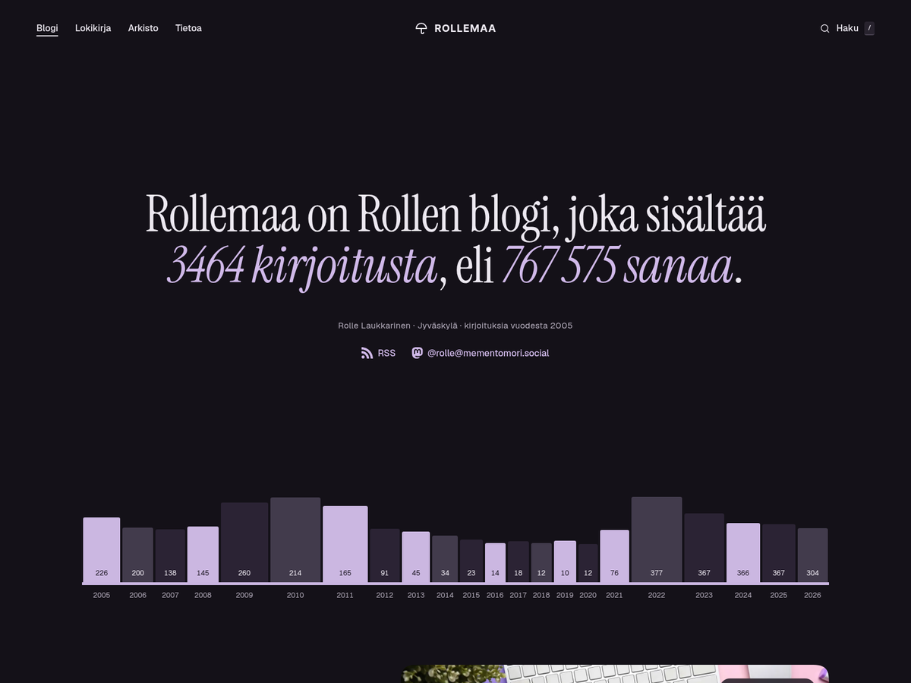

# The Purple People Eater - Rollemaa.fi WordPress theme v25/2026


**The WordPress theme of [Rollemaa.fi](https://www.rollemaa.fi), a Finnish personal blog with writing since 2005 and a daily diary, Lokikirja, since 2021.**



This theme is **not for the public to use**. It is made for my own website, it is in Finnish, and it depends on code that does not work anywhere else. It is here for backup and so you can see how it was done.

The previous theme is [Minimalist Madness](https://github.com/rollecode/minimalistmadness). This repository grew out of it, so its history goes back to 25.3.2020.

## Features

- Light and dark mode
- Full-height photo heroes with a photo credit from the image caption
- Automatic drop cap on an article's first paragraph
- Side notes in the margin of long articles
- Reading meter in the corner, and a way back to where you left off
- Callouts: Info, Varoitus and Kriittinen
- Word explanations: click a word for a card with an explanation and a link
- Wide and full images
- Real-time search overlay
- Lokikirja with moods, weather, device and a writing heatmap
- Fediverse reactions and comments under every text
- Claps and the passage readers highlight most
- AI summaries at the start of articles

## Structure

A block theme with no build step: what is in this repository is what runs.

```
the-purple-people-eater/
├── theme.json         Design tokens, layout sizes and block defaults
├── templates/         Pages as block markup
├── parts/             Header and footer
├── patterns/          Repeating pieces: cards, byline, diary parts
├── css/
│   ├── site.css       The design, also loaded in the editor
│   ├── blocks/        Styles loaded only with their block
│   ├── legacy.css     Markup of posts older than the block editor
│   └── prism.css      Code highlighting, loaded when needed
├── js/
│   ├── front-end.js   Interactions and the dynamic parts of a page
│   ├── gutenberg-editor.js  Editor settings
│   ├── heatmap.js     Writing heatmap on the diary archive
│   └── prism.js       Code highlighting, loaded when needed
├── fonts/             Instrument Serif, Atkinson Hyperlegible Next and Geist
├── svg/               Icon sprite and the diary's mood, device and weather icons
└── images/            Author photo and defaults
```

Core blocks do the work: Query Loop for the lists, post blocks for the texts, core navigation for the menu. `functions.php` loads assets and registers block styles. Posts open in the editor inside their template, so writing looks the same as reading.

Everything that is not presentation lives in the `rollemaa-site` mu-plugin in the site's own private repository: the diary, REST routes, search, comments from the fediverse. A theme switch never takes those with it.

## Credits

The theme started from [Air](https://github.com/digitoimistodude/air), Dude's starter theme, in 2020.

## License

All rights reserved. See [LICENSE](LICENSE).
